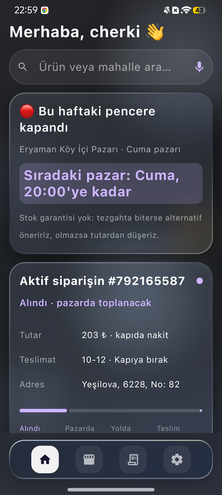

# 🛒 PazarSepeti

**Etimesgut'un pazarları artık kapında.**  
Tezgahtan sepete, kapıda nakit — aracı yok, sürpriz yok.

> 📲 **İNDİR:** [PazarSepeti v1.0.0 (APK)](https://github.com/emirizz1/PazarSepeti/releases/download/v1.0.0/PazarSepeti-v1.0.0.apk)  
> Kurulum: dosyaya dokun → "Bilinmeyen kaynak" uyarısına *İzin ver* de → Kur. Bu kadar.

---

## ✨ Neler var?

- **🏠 Ana Sayfa:** Bu haftaki pazar penceren açık mı, kapanışa ne kadar kaldı, aktif siparişin hangi adımda — tek ekranda.
- **🥬 Taze Katalog:** Ürünler fotoğraf + tahmini fiyatla listelenir; fiş fotoğrafıyla netleşir, stok biterse alternatif önerilir.
- **⚖️ Serbest Miktar:** kg ürünlerde yarımşar adım (500 g, 1,5 kg…) veya miktara dokunup elle yaz: `0,25` → 250 g. Üst sınır yok.
- **🗺️ Bölge Akıllı:** 38 mahalle → 17 pazar alanı. Mahallene göre pazar günü, kapanış saati ve servis ücreti otomatik.
- **📦 Çift Taraflı Onay:** Kurye "teslim ettim" der, sen "teslim aldım" dersin — sipariş ancak ikisiyle tamamlanır.
- **💬 Sipariş Sohbeti:** Kurye yoldayken mesajlaş; canlı konum + harita.
- **💵 Kapıda Nakit:** Online ödeme yok; kurye kasayı uygulamadan işaretler, şeffaf rapor.
- ** Grafit Gece / Krem Gündüz:** İki tema da **liquid glass** — alt menü gerçek cam: kaydırdıkça içerik camın altından buzlanarak akar.
- **👵 Herkes İçin:** Yazı boyutu kaydırmalı, adım adım uygulama rehberi, sade metinler, taşma yok.
- **🔐 KVKK:** Ad, telefon, adres yalnızca teslimat için saklanır. E-posta/SMS doğrulaması **yoktur**. Hesabını tek dokunuşla sildirebilirsin.

## 🧭 Nasıl çalışır?

1. **Kayıt ol** (telefon + ad yeter), mahalleni seç.
2. **Sepetini kur** — kg/adet karışık, serbest miktarla.
3. **Sipariş ver** → kurye sahiplenir → pazardan toplar → kapında.
4. **Teslim aldım** de, fiş fotoğrafını gör, kuryeni puanla.

## 🧪 Sürüm

| Sürüm | Kod | Not |
|---|---|---|
| **1.0.0** | 100 | İlk halka açık sürüm 🎉 |

## 🙋 Destek

Sorun mu var? Fikir mi? → [Issues](https://github.com/emirizz1/PazarSepeti/issues) aç, cevap hızlı gelir.  
Uygulama içinden de: **Hesabım › Yardım ve rehber**.

---

*PazarSepeti bir Etimesgut yerel girişimidir. Fiyatlar tahminidir; fiş esastır. Stok garantisi yoktur — tezgahta biterse alternatif önerilir, olmazsa tutar düşer.*
